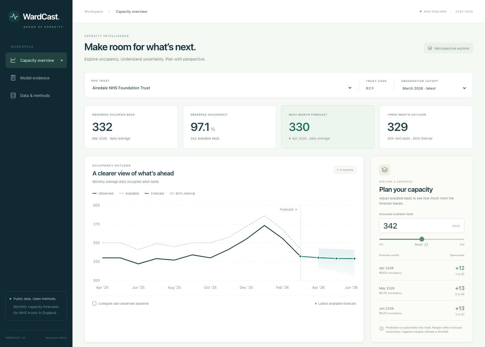
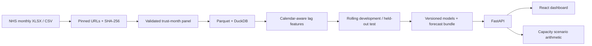

# WardCast

**Hospital capacity forecasts with visible uncertainty and reproducible evidence.**

WardCast forecasts monthly average daily occupied adult general-and-acute beds
for NHS trusts in England, one to three months after the latest observation.
Explore a trust's history, replay past forecasts, and compare predicted occupancy
with a capacity assumption. Every model is evaluated against simple baselines.



**Python 3.12 · React + TypeScript · FastAPI · LightGBM · CPU only · No API keys**

## What you can do

- Explore actual occupied and available beds, preserving missing observations.
- Inspect three monthly forecasts, nominal 80% prediction intervals, and feature explanations.
- Change an available-bed assumption to see occupancy and capacity margins.
- Replay historical observation cutoffs and compare forecasts with later outcomes.
- Inspect development/test scores, trust-level errors, winter performance, and source checksums.

The included data cover **April 2022–March 2026**: 48 source publications,
5,873 trust-month records, and 124 trust codes. The latest model produces forecasts
for 119 active, eligible trusts. The complete demo runs locally using the bundled
processed data and trained model outputs; no download or training is needed to
view it. Retired and short series retain their history without fabricated forecasts.

## Quickstart

Requires Python **3.12**, Node **22.12+**, and **pnpm 11.25.0**. Run from this repository.
Install pnpm with your preferred Node package manager if it is not available
(`npm install --global pnpm@11.25.0`).

```bash
python3.12 -m venv .venv
.venv/bin/python -m pip install -r requirements.lock
.venv/bin/python -m pip install --no-deps -e .
pnpm --dir frontend install --frozen-lockfile
pnpm --dir frontend build
.venv/bin/python -m wardcast serve
```

Open **http://127.0.0.1:8000**. API documentation is at
**http://127.0.0.1:8000/docs**. Serving is read-only and does not load a joblib
model or require OpenMP; it serves the verified precomputed forecast bundle.
After installing dependencies, `make demo` builds and starts the application.

On Windows use `.venv\Scripts\python.exe` in place of `.venv/bin/python`.
For frontend development, start the API and run `pnpm --dir frontend dev`;
Vite proxies `/api` to port 8000.

### Docker

```bash
docker compose up --build
```

The container builds the same frontend and runs the same API as a non-root user.
The published host port is bound to loopback. Docker is optional; the native
application and tests were run locally. Image execution requires Docker and is
also covered by the supplied CI workflow.

## Reproduce the research

```bash
# Fetch the pinned public files, normalize and audit, then train and evaluate.
.venv/bin/python -m wardcast reproduce

# Or run each stage separately.
.venv/bin/python -m wardcast download
.venv/bin/python -m wardcast prepare
.venv/bin/python -m wardcast train
.venv/bin/python -m wardcast inspect
```

The downloader verifies source SHA-256 checksums and refuses changed files.
Original sources are ignored by Git; the compact CSV/Parquet panel and trained
demo artifacts are included. Training uses two CPU threads, fixed seeds, and
fixed hyperparameters. On macOS the CLI can reuse scikit-learn's existing
OpenMP runtime; alternatively install `libomp` using Homebrew. Linux training
needs `libgomp1`, which the Dockerfile installs.

Training rebuilds `artifacts/demo.json`, `models.joblib`, `backtest.parquet`,
`evaluation.json`, and the benchmark/model-card documentation. Restart the API
after replacing artifacts. Only load serialized model files you trust.

## Measured results

All three horizons selected LightGBM using **development** MAE. These final-test
results use monthly expanding refits with frozen model choices and parameters.

| Horizon | LightGBM MAE | Persistence MAE | WAPE | Nominal 80% interval coverage |
|---|---:|---:|---:|---:|
| 1 month | 12.51 beds | 14.76 beds | 1.67% | 75.8% |
| 2 months | 15.56 beds | 19.73 beds | 2.08% | 76.2% |
| 3 months | 17.12 beds | 20.71 beds | 2.29% | 79.4% |

The intervals under-cover at all three horizons, especially one and two months.
This is reported rather than treated as a guaranteed probability. Errors are
averages across eligible trust forecasts; they do not describe every trust.
No statistical-significance or operational-impact claim is made.

Initial training ends March 2024. Development outcomes end March 2025. Test
outcomes run through March 2026, with 12, 11, and 10 target months for horizons
1, 2, and 3 respectively so model selection never sees an outcome after a test
origin. Comparisons use the same eligible examples within each horizon. See
[the benchmark report](docs/benchmark.md) for every candidate and the full protocol.

## Architecture



The forecasting system predicts a change from current occupied beds. Candidate
models are persistence, seasonal naive, trailing mean, Ridge, and shallow
LightGBM. Quantile models estimate uncertainty for LightGBM; baseline/Ridge
intervals use prior out-of-sample residuals. SHAP explanations describe the
tree model's predicted change and reconstruct its forecast additively.

The API deliberately serves an immutable, validated snapshot for this public
demonstration. Training is an explicit CLI operation, keeping normal browsing
fast, reproducible, and free of accidental retraining.

## Verification

```bash
make lint
make test

# With the API running on port 8000:
make browsers
make e2e
```

Python tests cover source schemas, aggregate exclusion, missing/zero observations,
trust-code changes, temporal leakage, candidate selection, intervals, additive
explanations, API validation, and scenario arithmetic. Browser tests exercise real
trust and cutoff selection, scenarios, evidence, and source views. GitHub Actions
runs the checks plus a container smoke test after publication of the repository.

## Important scope

The target is **monthly average observed occupancy**, not unmet demand, daily
surges, ward staffing requirements, or patient outcomes. Published source values
are revised and delayed. Replay is a simulation by observation month, not proof
of what was publicly available at that historical time. Changing scenario
capacity does not model a causal effect on occupied beds.

This is an independent portfolio/research demonstration using aggregate public
data. Live hospital integration and operational validation are outside this
release. No patient records, paid APIs, or cloud services are required.

## Explore the repository

- [Data definition and lineage](docs/data.md)
- [Benchmark report](docs/benchmark.md) and [model card](docs/model-card.md)
- [API contract](docs/api.md)
- [Release verification](docs/verification.md)
- [Interview walkthrough](docs/interview-walkthrough.md)
- [GitHub publication guide](docs/publishing.md)
- [Data attribution](DATA_LICENSE.md) and [MIT source licence](LICENSE)

